# drop

**La réponse, pas l'accès.**

[English](README.md)

[](https://github.com/guillaume-flambard/drop/actions/workflows/test.yml)
[](https://scorecard.dev/viewer/?uri=github.com/guillaume-flambard/drop)
[](LICENSE)

drop est une couche de consentement pour les questions entre agents IA. Votre agent a besoin d'une information qui vit dans les outils d'un collègue : un dépôt, une maquette, des logs de production. Au lieu de demander un accès, il envoie une question bornée, par MCP ou A2A. Le collègue propriétaire de la source voit qui demande et pourquoi, puis autorise cette seule réponse. Le travail se fait sur la machine du propriétaire, et seule la réponse approuvée revient.

**La promesse.** Vos données restent sur votre machine. Seule une réponse que vous avez approuvée en sort, chiffrée, vers la personne qui l'a demandée.

**Sa limite.** drop contrôle ce qui passe par drop. Un connecteur MCP ou un modèle choisi par le propriétaire peut avoir ses propres flux, que drop ne voit pas.

`drop` est un nom de code ; le nom du produit n'est pas encore choisi.

## État

drop est un prototype jeune. À lire avant toute évaluation.

- **Aucun utilisateur réel pour l'instant.** Toutes les démonstrations ont tourné sur les machines du mainteneur. Le besoin lui-même est encore en cours de mesure.
- **L'app Mac** (barre de menus, Apple Silicon) se construit signée et notarisée, mais il n'existe encore ni version publiée ni téléchargement. La recette sur un Mac neuf et le test VoiceOver restent à faire.
- **Les apps Windows et Linux** sont en cours et pas encore disponibles.
- **Aucun audit de sécurité indépendant.** Deux renforcements anti-rejeu attendent encore leur revue formelle.
- Pas de version stable, pas de paquet npm, aucune promesse de compatibilité. `main` avance vite.

Le bilan daté est dans [docs/AVANCEMENT.md](docs/AVANCEMENT.md) et l'index ordonné des tâches dans [docs/TASKS.md](docs/TASKS.md).

## Fonctionnement

<picture>
  <source media="(prefers-color-scheme: dark)" srcset="docs/diagrams/one-question-dark.svg">
  
</picture>

1. Le propriétaire publie une **capacité** : un contrat qui fixe l'entrée, le schéma de sortie, les outils autorisés, le budget et l'approbateur. Rien n'est partagé par défaut.
2. L'agent du demandeur choisit une capacité dans le catalogue de l'équipe et pose une question avec sa raison.
3. Le propriétaire décide une fois : autoriser une fois, refuser ou pas maintenant. Sans accord avant l'expiration, rien ne s'exécute.
4. Le Node du propriétaire exécute la capacité avec les outils fixés à l'avance. Le modèle ne décide jamais des permissions.
5. La sortie est validée par son schéma puis passée au scanner de secrets. Une sortie invalide est rejetée, pas réparée. Pour une capacité sensible, le propriétaire relit la réponse, peut retirer des champs, puis l'envoie ou ne l'envoie pas.
6. Le demandeur reçoit la réponse. Chaque côté garde un reçu signé, avec des empreintes et des métadonnées, jamais le contenu.

Le [guide](docs/GUIDE.md) détaille le parcours avec des schémas.

## Ce qui existe aujourd'hui

Tout ce qui suit est sur `main` et couvert par des tests. Les numéros renvoient à [docs/TASKS.md](docs/TASKS.md).

- **Protocole.** Identités et signatures Ed25519, chiffrement X25519 (`crypto_box` de libsodium), schémas zod pour chaque message, contrôles anti-rejeu, reçus signés (T1.1, T1.2).
- **Capacités.** `production.error_summary` résume des logs sans aucun modèle. `repo.answer` répond sur un dépôt à partir d'une copie temporaire en allowlist. `mcp.answer` répond à partir d'un serveur MCP que le propriétaire utilise déjà, avec des outils en lecture seule choisis à la publication. `a2a.answer` interroge un agent A2A interne approuvé (T1.7, T1.13, T2.2, T2.15).
- **Deux échanges sans modèle.** Le propriétaire peut répondre à la main, par un texte ou un fichier texte, avec le même consentement et le même reçu (T4.3). Il peut publier des faits signés, avec un public et une date de fin, servis sans nouvelle décision (T4.4).
- **Côté demandeur.** Un serveur MCP stdio à six outils, dont `ask_team` pour poser une question à l'équipe en langage courant et `request_drops` pour interroger plusieurs propriétaires à la fois (T1.10, T2.10, T2.12). L'équipe est aussi joignable comme agent A2A v1.0, et chaque tâche A2A passe par le consentement (T2.14).
- **Raccordement des agents.** Treize clients MCP détectés et raccordés automatiquement sur macOS, Windows et Linux, commentaires et mise en forme de leurs fichiers gardés ; la configuration à copier ne reste qu'en secours, expliquée (T3.3, T4.5, T4.22).
- **Profil privé.** Créé par `drop init` et par l'app : destinations réseau explicites, aucun repli cloud, un endpoint de modèle local sans modèle présélectionné, et le propriétaire paie son propre modèle (T3.1).
- **Trois chemins de connexion, aucun imposé.** Découverte sur le réseau local par mDNS, Internet par iroh (un programme Rust séparé, désactivé par défaut), ou un relais exploité par votre équipe (T4.2, T4.2b). Le relais ne voit que des enveloppes chiffrées et des métadonnées de routage.
- **Pack entreprise.** Une politique signée par l'organisation, appliquée à chaque poste et au relais, plus une image Docker et un chart Helm du relais (T4.10).
- **App Mac de barre de menus.** Tauri 2, cartes de consentement, relecture champ par champ, invitations confirmées (T4.14). Des builds signées et notarisées existent pour Apple Silicon ; aucun téléchargement public (T3.4).
- **blocked-observer.** Un petit outil local qui mesure combien de fois un agent de code est bloqué par une ressource qui appartient à quelqu'un d'autre. C'est lui qui sert à mesurer le besoin (T0.1 à T0.6).

La passerelle grand public de `packages/gateway` (MCP distant pour les assistants hébergés) est mise de côté, et le profil privé la refuse.

## Démarrage pour les développeurs

Il faut Node 22.18 ou plus récent (la CI utilise Node 24) et pnpm 11.27.0, la version fixée dans `package.json`.

```bash
git clone https://github.com/guillaume-flambard/drop.git
cd drop
pnpm install --frozen-lockfile
pnpm -r lint
pnpm -r typecheck
pnpm -r test
```

Les tests utilisent des fixtures et des fournisseurs de modèle simulés. Ils ne demandent ni clé d'API ni service réseau.

### Démo locale

```bash
bash scripts/demo-local.sh
```

Le script lance un relais et trois Nodes sur `127.0.0.1` (ports 7790 à 7793) dans un dossier temporaire, puis joue deux scénarios par le serveur MCP du demandeur :

- **Résumé des erreurs de production.** Aucun modèle ni clé : demande, accord, résultat, reçus et contrôle de fuite.
- **Une question sur le dépôt d'une collègue** (`repo.answer`). Cette partie appelle un modèle distant par OpenRouter et demande `OPENROUTER_API_KEY`. Sans clé, elle s'arrête après l'accord.

Les Nodes de la démo utilisent le profil historique (`--profile legacy`) : elle ne prouve donc pas le profil privé. Pour une installation privée à la main, suivre [le guide du profil privé](docs/PRIVATE_PROFILE.md).

### Brancher son agent

```bash
node packages/node/src/cli.ts init --name Alice --relay ws://127.0.0.1:7780/v1
node packages/node/src/cli.ts serve
node packages/node/src/cli.ts help
```

Le raccordement des agents, la configuration MCP manuelle et les treize clients sont décrits dans [docs/ONBOARDING.md](docs/ONBOARDING.md) et [packages/requester-mcp/README.md](packages/requester-mcp/README.md).

## Organisation du dépôt

<picture>
  <source media="(prefers-color-scheme: dark)" srcset="docs/diagrams/architecture-overview-dark.svg">
  
</picture>

[docs/ARCHITECTURE.md](docs/ARCHITECTURE.md) explique comment l'app de bureau, le Node et l'interface s'assemblent.

| Chemin                      | Contenu                                                                        |
| --------------------------- | ------------------------------------------------------------------------------ |
| `packages/protocol`         | Schémas zod, identité, signature, chiffrement, reçus                           |
| `packages/relay`            | Routage WebSocket et admission                                                 |
| `packages/node`             | Identité, CLI, orchestration, API et panneau locaux, détection et installation |
| `packages/runner`           | Pipeline d'exécution, budgets et contrôles de sortie                           |
| `packages/capabilities`     | Capacités déterministes, dépôt, MCP et A2A                                     |
| `packages/requester-mcp`    | Serveur MCP stdio qui parle à l'API locale du Node                             |
| `packages/a2a`              | Adaptateur A2A entrant                                                         |
| `packages/blocked-observer` | Mesure locale du besoin                                                        |
| `packages/simulation`       | Banc local de Nodes simulés                                                    |
| `packages/gateway`          | Passerelle grand public facultative, mise de côté                              |
| `packages/desktop-ui` | Interface React + shadcn/ui affichée dans l'app de bureau |
| `apps/desktop` | Coque Tauri 2 de l'app de bureau (macOS, Windows, Linux) |
| `crates/drop-iroh`          | Connexion par Internet avec iroh                                               |
| `deploy/helm`               | Chart Helm du relais                                                           |
| `openspec/`                 | Spécifications (le contrat) et historique des changes                          |
| `docs/`                     | Guide, décisions, index des tâches, documents produit                          |

## Modèle de sécurité

Ces règles valent dans le code et pour toute contribution :

- Une requête d'un pair est une donnée non fiable. Elle est validée par zod et passée au modèle comme donnée encadrée, jamais comme instruction.
- La capacité fixe les outils avant l'appel au modèle. Le modèle n'élargit jamais la frontière d'autorisation.
- La lecture de fichiers se fait en allowlist, dans une copie temporaire.
- Chaque sortie est validée par le schéma de la capacité et passée au scanner de secrets avant de partir.
- Logs, reçus et télémétrie ne contiennent que des empreintes et des métadonnées, jamais de secret ni de contenu.
- Le runner n'écoute sur aucun port. Les Nodes se connectent en sortie au relais ; l'API locale et le panneau écoutent sur la boucle locale.
- Les clés privées vivent dans `~/.drop/` en mode `0600`.

Limites connues : le chiffrement et le scanner de secrets ne prouvent pas l'absence de toute fuite. Une réponse livrée ne se rappelle pas. Le catalogue révèle qui sait quoi. Plusieurs réponses partielles peuvent s'additionner. L'approbation peut devenir un réflexe. Les connecteurs, modèles et agents A2A choisis par le propriétaire font partie de la frontière à examiner.

Les vulnérabilités se signalent en privé, selon [SECURITY.md](SECURITY.md) (en anglais).

## Documentation

- [Le guide](docs/GUIDE.md) : le parcours, la démo, ce qui reste privé
- [Le PRD](docs/product/PRD.md) : la cible, la promesse et sa limite, les hypothèses
- [La vision](openspec/project/vision.md) et [l'architecture](openspec/project/architecture.md)
- [Architecture](docs/ARCHITECTURE.md) : où vit chaque partie du dépôt et d'où vient chaque build
- [Les spécifications](openspec/specs/) : le contrat normatif et ses scénarios d'acceptation
- [Les décisions](docs/DECISIONS.md) : chaque choix produit et technique, avec sa raison
- [Socle ouvert et modèle économique](docs/OPEN_SOURCE.md)

## Feuille de route

[docs/TASKS.md](docs/TASKS.md) est la seule source de l'ordre et des dépendances. En résumé : fermer les revues de sécurité en attente, finir l'app Mac, livrer les apps Windows et Linux, un lien unique pour rejoindre une équipe, puis un essai en binômes de collègues qui travaillent vraiment ensemble. Le lancement public, les paquets et le nom du produit viennent ensuite.

<picture>
  <source media="(prefers-color-scheme: dark)" srcset="docs/diagrams/roadmap-phases-dark.svg">
  
</picture>

Le lien unique pour rejoindre est un parcours cible, en cours (T4.23) :

<picture>
  <source media="(prefers-color-scheme: dark)" srcset="docs/diagrams/join-two-clicks-dark.svg">
  
</picture>

## Contribuer

Les contributions sont bienvenues. Commencer par [CONTRIBUTING.md](CONTRIBUTING.md) et le [code de conduite](CODE_OF_CONDUCT.md) (en anglais). Les questions vont dans [GitHub Discussions](https://github.com/guillaume-flambard/drop/discussions) ; voir [SUPPORT.md](SUPPORT.md).

## Licence

Copyright 2026 Guillaume Flambard. Sous [licence Apache, version 2.0](LICENSE). Voir [NOTICE](NOTICE). Les composants tiers et les poids de modèles gardent leurs propres licences.
