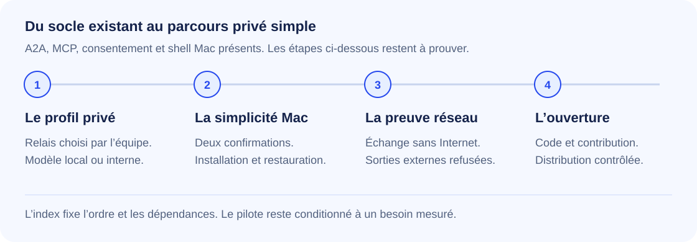

# Où en est drop ?

**Bilan du 9 octobre 2026.** T3.1 implémente le profil privé sur la base de T3.0/T3.0a. Ce bilan ne certifie ni un serveur distant ni une distribution publique.

**Le runtime privé est implémenté et son cycle fonctionne sans Internet avec des fixtures internes.** Les deux confirmations, la qualification d’un vrai modèle et la distribution Mac restent à livrer. Tauri existe déjà sur Mac ; son bootstrap choisit désormais un relais privé.



## Ce qui existe dans le code

| Partie                                           | Preuve inspectable                                                                           | Limite                                                                              |
| ------------------------------------------------ | -------------------------------------------------------------------------------------------- | ----------------------------------------------------------------------------------- |
| Identité, enveloppes, anti-rejeu                 | [Protocole et tests](../packages/protocol/)                                                  | Ne prouve pas toute la confidentialité applicative                                  |
| Relais, admission, équipes                       | [Relais](../packages/relay/), [tests Node](../packages/node/test/)                           | Admission, révocation et restauration revérifiées dans T3.1                                       |
| Consentement, relecture, budgets, sorties        | [Node](../packages/node/), [runner](../packages/runner/)                                     | Pas de garantie absolue de non-divulgation                                          |
| Résumé d'erreurs, dépôt, MCP et A2A sortant      | [Capacités](../packages/capabilities/)                                                       | Connecteurs et modèles réels à qualifier par environnement                          |
| A2A entrant                                      | [Adaptateur](../packages/a2a/), commit `0e9caa8`                                             | SDK 1.3.0 ciblant A2A 1.0 ; pas une certification de tout le standard               |
| Questions d'équipe et demandes multiples         | [Connecteur MCP](../packages/requester-mcp/)                                                 | Routage borné, pas un orchestrateur général                                         |
| Détection et installation individuelles          | [Détection](../packages/node/src/detect.ts), [installation](../packages/node/src/install.ts) | Quatre adaptateurs ; transaction groupée réversible à construire                    |
| Shell Mac de barre de menus                      | [Tauri](../apps/mac/)                                                                        | Bootstrap privé ; distribution signée non qualifiée                                                         |
| Financement demandeur et passerelle grand public | [Financement](../packages/node/src/funding.ts), [gateway](../packages/gateway/)              | Financement sans substitution ; passerelle exclue du profil privé |
| Mesure du besoin                                 | [Observer](../packages/blocked-observer/)                                                    | D24 attend toujours un agrégat qualifié concluant                                   |

L’URL LLM proposée est Ollama local, sans choix implicite de modèle. Le propriétaire choisit son modèle et ses destinations, sans repli cloud. Aucun poids réel n’a encore été qualifié.

## Preuve T3.1

La recette Docker `--network none` exécute sept scénarios : installation neuve et invitation, accord/relecture/réponse via MCP et modèle, refus, panne du modèle, reprise du relais, reprise des Nodes, révocation et restauration. Capture sur toutes les interfaces du conteneur : **510 paquets, tous sur loopback, aucun paquet perdu par la capture**, aucune route externe ; la sonde extérieure échoue en `ENETUNREACH`. Les clés et contenus ne sont pas conservés dans la capture.

La [recette du profil privé](PRIVATE_PROFILE.md) explique installation, migration, retour arrière et exploitation. Limites explicites : IP privées littérales seulement, sans DNS ni redirection ; sources MCP stdio non isolées refusées ; les services autorisés doivent eux-mêmes être isolés par le client. Cette preuve utilise des fixtures, pas un vrai modèle ni un agent personnel. Les sorties restent soumises aux schémas et au scanner ; aucune promesse universelle de non-divulgation.

La revue indépendante ne constate aucun défaut P1/P2 résiduel dans les chemins examinés. L’audit CSO automatique reste partiel ; son ancien constat HTTP 600 a une correction et une preuve native, mais n’est pas formellement clos par cet outil. Les [preuves T3.1](../openspec/changes/archive/2026-10-09-t3-1-private-profile/evidence.md) conservent tous les résultats : **262 tests / 33 fichiers**, lint/types, OpenSpec strict, bundles et compilation Rust passent. Le guard relie 88 critères ; 258 hérités restent gelés et 19 sont déclarés non testables. Baseline +0/-1. État : READY_FOR_MANUAL_ACCEPTANCE.

## Ce que T3.0 prépare

- Vision et architecture privées, décisions D34 à D38, [critères d'exécution futurs](ACCEPTANCE.md).
- [Parcours deux confirmations](ONBOARDING.md), [modèles candidats](MODELS.md), index réordonné avec reprise des anciens restes.
- Licence Apache-2.0, contribution, signalement de sécurité et modèles GitHub.
- Landing et guide en prévisualisation locale, avec échanges simulés et limites explicites.

Vérification T3.0 : **245 tests réussis dans 26 fichiers**, lint/types et validation OpenSpec stricte verts. Le guard compte 355 critères : 75 liés à un test, 259 hérités gelés, 21 non testables (dont les six critères éditoriaux de T3.0). Baseline inchangée. Les [preuves et la revue](../openspec/changes/archive/2026-10-09-t3-0-sovereign-oss-foundation/evidence.md) sont conservées dans l’archive. Les critères documentaires ne comptent pas comme des tests du futur runtime. Un garde vert avec baseline signifie absence de nouvelle dette de traçabilité ; il ne signifie pas que chaque scénario hérité est couvert.

## Preuves historiques

La [démo conservée](demo/README.md) rapporte des passages Claude Code et Codex via le lab : résumé de logs du VPS et question sur un dépôt avec relecture. Le Node nommé Julie était sur le Mac de Guillaume, pas chez Julie. Le test humain de compréhension n'est pas prouvé. Ces captures ne démontrent pas le nouveau parcours privé.

L'ancien bilan `cacf1cc` est conservé dans l'historique Git. Ses chiffres de tests et tâches ne sont pas repris comme mesure actuelle.

## Ce qui reste

L'ordre unique est [TASKS](TASKS.md). Après T3.1 : évaluation Hermes (T3.1a), puis qualification de modèle et connexion, finition Mac, preuve d'ensemble, préparation de publication, Windows et Linux. Les anciennes tâches en cours ont été remises à `todo` avec leur reprise explicite ; elles ne sont pas déclarées terminées.

Deux évaluations complémentaires sont maintenant inscrites : **T3.1a**, Hermes comme agent demandeur via MCP, et **T3.2a**, adaptateurs AI SDK directs / passerelle LiteLLM privée. Aucun n’est installé ni intégré ; ils ne bloquent pas le parcours privé. Les critères incluent erreurs, destinations réseau et absence de dépendance cloud obligatoire. Le client actuel reste celui de la première preuve.

D24 exige au moins trois développeurs et dix jours actifs chacun. Le GO exige au moins 0,5 blocage YES par développeur-jour et une médiane de dix minutes perdues. Aucun agrégat qualifié concluant n'est apporté par cette documentation.

Le dépôt demeure privé. Avant ouverture : audit de l'historique et des artefacts, attributions tierces, séparation de la CI du lab, signalement privé opérationnel, paquets vérifiés et accord du propriétaire. Voir [OPEN_SOURCE](OPEN_SOURCE.md).

## Reproduire la vérification

```bash
pnpm -r lint
pnpm -r typecheck
pnpm -r test
openspec validate --all --strict
npx --yes openspec-guard@0.3.0 check --require-selector --baseline .openspec-guard-baseline.json --fail-on fail
pnpm site:build
```

Ces tests ne requièrent ni clé modèle ni accès au lab. Le site est une présentation statique ; sa simulation ne connecte aucun agent et n'envoie aucune demande réelle.
