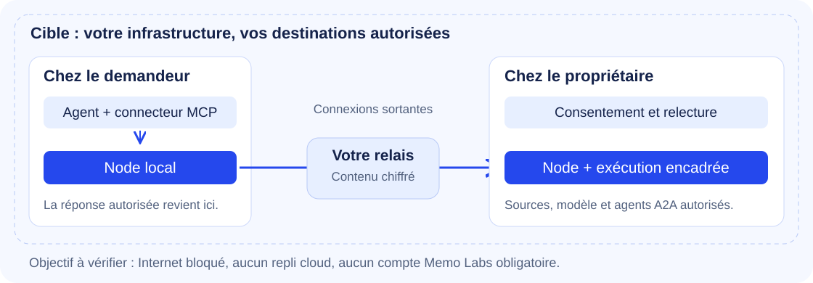

# Comprendre drop

**Obtenir la réponse. Garder la maîtrise de ses accès.**

Votre agent a besoin d'une information détenue par un collègue. Avec drop, il lui adresse une demande précise. Le collègue choisit de l'autoriser ; son environnement exécute une action définie à l'avance ; votre agent reçoit la réponse autorisée.

`drop` est un nom de code (D57). Positionnement adopté le 10 octobre 2026 (D47 à D58) : « la réponse, pas l'accès », couche de consentement humain au-dessus d'A2A. La référence produit est [`docs/product/`](product/PRD.md) ; en cas d'écart, elle fait foi sur ce guide. Ce guide décrit ce qui existe et signale ce qui est visé, avec la tâche qui le porte.

Existant : le profil privé (T3.1) et le raccordement en deux confirmations de quatre agents (T3.3, `packages/node/src/onboarding.ts`), vérifié dans le panneau local sur fixtures, recette humaine sur un Mac de test à faire. Rien n'a encore été validé avec de vrais utilisateurs. Le [bilan daté](AVANCEMENT.md) précise les preuves.

## La cible privée

Aujourd'hui, un relais interne relie les postes (existant, `packages/relay`) ; aucun serveur Memo Labs ni compte externe ne doit être requis. Réseau local par découverte mDNS, Internet par iroh embarqué et relais d'entreprise packagé sont visés (T4.2, T4.10, D53), sans relais de secours activé par défaut. Le modèle peut être sur le laptop ou dans l'entreprise. Les destinations des modèles, connecteurs et agents joints doivent être approuvées : avoir l'app sur son Mac ne rend pas une API cloud locale.

L'app conserve Tauri 2 et le moteur partagé (existant, `apps/mac`, paquet de développement). Distribution signée et notarisée visée en T3.4, puis Windows (T3.7) et Linux (T3.8). Après installation et environnement prêt : analyser les configurations compatibles, puis raccorder les agents sélectionnés. Ce parcours de deux confirmations ne publie aucun outil. Invitations, permissions système et téléchargements sont séparés. Voir [ONBOARDING](ONBOARDING.md).

Sans modèle, les capacités déterministes fonctionnent (existant, `production.error_summary`). Réutiliser d'abord le modèle existant est visé en T3.2 ; Ollama avec Qwen3.5 4B/9B y est une option à mesurer, avec téléchargement volontaire et aucun fallback distant dans le profil privé cible. Voir [MODELS](MODELS.md).

Rien n'est payant avant d'avoir des utilisateurs (D57) et la sécurité n'est jamais une option payante (D38). Contrats de support et pack entreprise restent des hypothèses sans tarif (PRD, H6). [OPEN_SOURCE](OPEN_SOURCE.md) fixe la frontière et les étapes avant publication.

## Une question, un accord, une réponse

Guillaume veut savoir si le dépôt de Julie gère le mode sombre. Il n'a pas besoin d'obtenir tout le dépôt pour prendre sa décision.

C'est le scénario que joue réellement la démonstration (`scripts/demo-local.sh`, capacité `repo.answer`). Ses trois Nodes tournent sur la même machine, en `127.0.0.1` ; dans la [démo conservée](demo/README.md), le Node « Julie » était sur le Mac de Guillaume. Julie est un personnage de scénario, pas une utilisatrice. Les cas Figma, Notion ou Linear cités plus bas et dans le PRD sont des scénarios visés, pas la démonstration.


1. **Demander.** L'agent choisit une capacité disponible et pose une question, accompagnée d'une raison lisible.
2. **Autoriser.** Julie voit qui demande, pourquoi, ce qui pourra être renvoyé et le coût annoncé. Elle peut accepter une fois, refuser ou répondre « pas maintenant ».
3. **Exécuter chez le propriétaire.** La capacité utilise seulement les outils prévus. Pour un dépôt, elle travaille dans une copie temporaire des fichiers autorisés.
4. **Relire si la capacité est sensible.** Julie voit la réponse de `repo.answer` ou de `mcp.answer` avant son envoi. Dans le panneau de l'app (`/app`), elle choisit « Envoyer » ou « Ne pas envoyer ». Retirer des champs n'existe aujourd'hui que sur la page historique `/` (`packages/node/src/ui.ts`) et en ligne de commande (`review <dropId> send --redact <champ>`) ; le retrait dans le panneau est visé en T4.14.
5. **Recevoir.** L'agent de Guillaume obtient une réponse structurée. Un reçu signé conserve des empreintes et des métadonnées, sans recopier la question ni la réponse.

Un refus arrête cette demande. « Pas maintenant » ne planifie pas une relance automatique. Sans accord avant l'expiration, la capacité ne s'exécute pas. Un résultat invalide ou détecté comme secret par les contrôles de sortie n'est pas envoyé.

## Ce que drop sait faire aujourd'hui

| Capacité                   | Exemple de question                            | Résultat prévu                                          | Relecture                                          |
| -------------------------- | ---------------------------------------------- | ------------------------------------------------------- | -------------------------------------------------- |
| `production.error_summary` | « La production va bien depuis une heure ? »   | État, compteurs et catégories d'erreurs                 | Pas de seconde relecture ; traitement déterministe |
| `repo.answer`              | « Le mode sombre est-il déjà implémenté ? »    | Réponse courte, verdict et noms de fichiers             | Oui                                                |
| `a2a.answer.<nom>`         | « Que sait cet agent interne sur le projet ? » | Réponse d’un agent A2A approuvé, bornée par la capacité | Oui                                                |
| `mcp.answer.<nom>`         | « Cette maquette prévoit-elle un état vide ? » | Réponse courte, verdict et noms de sources              | Oui                                                |

Toutes ces capacités demandent une autorisation initiale. Les capacités dépôt et MCP utilisent un modèle ; un agent A2A joint utilise sa propre implémentation. Le résumé d'erreurs ne nécessite pas de modèle.

Une capacité est un **contrat d'action** : une entrée, une sortie, des outils autorisés, une sensibilité et un budget. Le demandeur choisit dans ce catalogue ; il ne transmet pas une liste de nouveaux outils à exécuter.

`mcp.answer` est un adaptateur générique. Figma, Notion, Linear ou GitHub sont des usages possibles lorsqu'un serveur MCP approprié est déjà configuré chez le propriétaire. Ce sont des scénarios visés : aucune de ces intégrations n'a été validée chez un utilisateur. En profil privé, un serveur source MCP stdio est refusé (`E_DENIED`, `packages/capabilities/src/mcp-answer.ts`) ; seul un serveur HTTP sur une origine privée autorisée peut servir de source.

## Comment les pièces s'assemblent



| Pièce           | Son rôle                                                                         |
| --------------- | -------------------------------------------------------------------------------- |
| Agent demandeur | Claude Code, Codex ou un autre client capable d'utiliser le serveur MCP          |
| `requester-mcp` | Traduit les outils de l'agent en appels à l'API locale du Node                   |
| Node            | Processus local qui porte l'identité, gère les demandes et se connecte au relais |
| Relais          | Route les enveloppes chiffrées entre les Nodes, même à distance                  |
| Approbateur     | Personne qui décide ; son Node peut différer de celui qui exécute                |
| Runner          | Exécute la capacité et contrôle la sortie                                        |
| Reçu            | Trace signée avec empreintes, décision, outils et horodatages                    |

Exemple : le VPS peut résumer ses propres logs pendant que Guillaume autorise la demande sur son Mac. Les connexions au relais partent des Nodes. L'interface de consentement et l'API du Node écoutent sur la boucle locale ; le runner n'expose pas de port.

### Les outils de l'agent

Le serveur MCP du demandeur expose six outils (existant, `packages/requester-mcp/src/server.ts`) :

```text
ask_team             Poser une question à l'équipe en langage courant ; routage déterministe, trois cibles au plus
list_capabilities    Découvrir les réponses disponibles chez ses pairs
request_drop         Envoyer une demande pour une capacité
get_drop_result      Attendre ou récupérer le résultat d'une demande (0 à 50 s, 30 par défaut)
request_drops        Envoyer une même question à 2 à 10 capacités ; rien ne part si une entrée est invalide
get_drop_results     Attendre ou récupérer les résultats de plusieurs demandes (0 à 50 s, 30 par défaut)
```

`request_drop` reçoit `capability_id`, `input` et `purpose`. L'entrée est validée localement avant envoi. Le résultat d'un pair est encadré comme une donnée non fiable, pas comme une instruction à suivre.

## Ce qui circule et ce qui reste chez soi

La distinction essentielle est **qui reçoit quoi**.

| Destinataire                            | Ce qu'il peut recevoir                                                                                |
| --------------------------------------- | ----------------------------------------------------------------------------------------------------- |
| Demandeur                               | Sortie conforme au contrat et autorisée ; aucun accès permanent au dépôt ou à l'outil du propriétaire |
| Relais                                  | Enveloppes chiffrées et métadonnées de routage ; pas le contenu déchiffré                             |
| Propriétaire / exécuteur                | Question et raison de la demande ; accès à ses propres sources                                        |
| Fournisseur du modèle, s'il est distant | Question et contexte transmis au modèle, notamment les résultats des outils qu'il utilise             |

**Le propriétaire choisit son modèle.** L’URL proposée est Ollama sur loopback, sans choix implicite de modèle ni téléchargement. Le profil privé impose des origines privées explicites et refuse redirections, DNS et serveurs source MCP stdio. Les services internes doivent eux-mêmes être isolés par le client. Il reste à qualifier un vrai modèle et ses outils. Voir [le guide du profil privé](PRIVATE_PROFILE.md).

Le chiffrement protège le transport entre Nodes. Les listes d'outils, schémas, budgets, filtres et relectures limitent ce qui est exécuté et renvoyé. Ils ne constituent ni un audit de sécurité indépendant, ni un bac à sable système, ni une garantie absolue contre la divulgation. Les annotations de lecture seule d'un serveur MCP ne remplacent pas l'examen des outils que l'on choisit de partager.

## Qui paie le modèle ?

**Contrôle livré en T3.1.** Le financement ne remplace ni le modèle ni l’endpoint du propriétaire. Un financement incompatible est refusé avant appel ; en profil privé payé par le propriétaire, toute clé reçue est refusée avant consentement.

Le financement par le demandeur est implémenté pour le profil historique seulement, puisque le profil privé créé par `drop init` refuse toute clé reçue (le schéma ne l'impose pas encore, T4.15) : une clé plafonnée est créée pour la demande et transmise chiffrée à l'exécuteur. Elle n'est pas écrite sur son disque. Le coût annoncé et le payeur apparaissent sur la carte ; le cycle de fin de demande prévoit la révocation de la clé. Ce chemin dépend d'une configuration de financement valide.

Le propriétaire peut aussi utiliser sa propre clé. La démo historique suit ce second chemin. Les valeurs par défaut et les fournisseurs peuvent évoluer : les prix et disponibilités ne sont pas garantis par cette documentation. Voir [D21, D27 et D40, qui remplace D20](DECISIONS.md) et les [tests de financement](../packages/node/test/funding.test.ts).

## Essayer le prototype

### Vérifier le dépôt sans utiliser de modèle

Prérequis : un clone du dépôt, Node **22.18 ou supérieur**, et la version de pnpm déclarée dans `package.json` (**11.27.0** lors de ce bilan). Depuis la racine :

```bash
pnpm install --frozen-lockfile
pnpm -r lint
pnpm -r typecheck
pnpm -r test
```

Les tests incluent des parcours avec relais et Nodes locaux, ainsi que des fournisseurs simulés. Ils ne nécessitent pas de clé LLM.

### Voir le site et la documentation

```bash
pnpm site:preview
```

Ouvrir l'adresse locale affichée. La prévisualisation est séparée du produit : sa démonstration n'envoie aucune demande. `pnpm site:build` prépare les fichiers statiques dans `dist/site/`.

### Rejouer la démo complète

```bash
bash scripts/demo-local.sh
```

Le script crée un dossier temporaire, un relais et trois Nodes, puis joue le résumé d'erreurs et la question sur le dépôt. Les trois Nodes sont initialisés en profil historique (`--profile legacy`) : cette démo ne prouve pas le profil privé. Il utilise les ports **7790 à 7793**, qui doivent être libres, et arrête ses processus en quittant. Il laisse le dossier de démonstration pour inspection.

**La partie `repo.answer` utilise le réseau et requiert une clé OpenRouter.** Le script lit `OPENROUTER_API_KEY`, ou essaie une entrée du trousseau macOS nommée `OpenRouter API Key`. Il ne faut pas présenter ce script comme une démonstration entièrement hors ligne ou sans prérequis. Sa durée dépend aussi du fournisseur. La clé doit être configurée dans l'environnement, jamais ajoutée au dépôt.

### Brancher son agent

Initialiser un Node avec l'URL d'un relais autorisé, puis lancer `serve`. Sans `--profile legacy`, `init` crée un profil privé (`packages/node/src/cli.ts`). L'identité locale vit par défaut dans `~/.drop` ; les clés privées sont créées en mode `0600`.

```bash
node packages/node/src/cli.ts help
node packages/node/src/cli.ts init --name Guillaume --kind human --relay <URL_DU_RELAIS>
node packages/node/src/cli.ts serve
```

Remplacer `<URL_DU_RELAIS>` par l'adresse obtenue auprès de son opérateur. L'admission et l'appairage nécessitent une invitation valide, ou l'autorisation d'amorçage du relais. Le [guide du connecteur](../packages/requester-mcp/README.md) donne les configurations Claude Code et Codex.

L’installation locale du connecteur est aussi disponible après assemblage :

```bash
node scripts/bundle.ts
node packages/node/src/cli.ts install codex
```

Remplacer `codex` par `claude_code`, `cursor` ou `claude_desktop` selon l’agent : ce sont les quatre adaptateurs existants. Les neuf autres clients de D55 sont visés en T4.5. Cette commande modifie sa configuration. `uninstall <agent>` retire le connecteur. Le paquet npm public n’est pas encore publié. `node scripts/bundle.ts` nettoie `dist/` : reconstruire ensuite le site si nécessaire.

Dans le panneau local, « Mes outils » propose le parcours guidé : « Analyser ce Mac », choisir les agents, puis « Connecter les agents sélectionnés ». Une configuration changée depuis l'analyse est refusée ; aucune capacité n'est publiée par ce raccordement. La commande CLI suit les mêmes contrôles de conflit et de sauvegarde pour l'agent nommé.

Un annuaire d’équipe est implémenté : `team create <nom>` initialise l’équipe ; les invitations propagent l’adhésion et l’appairage ; `team` liste les membres, leurs agents et leurs capacités. Dans le panneau, un lien `drop://pair` est accepté dès l'ouverture, sans clic de confirmation ; la confirmation explicite est visée en T4.14. L'app Mac existe en paquet de développement (`apps/mac`) ; sa distribution signée et notarisée reste à prouver en T3.4.

Pour examiner les agents reconnus et les sources déjà configurées :

```bash
node packages/node/src/cli.ts detect
node packages/node/src/cli.ts help
```

La commande `share <agent>/<serveur>` permet ensuite de publier une source existante. Dans le panneau, l'interrupteur de « Mes outils » fait la même chose en un clic (`packages/node/src/panel.ts`, `packages/node/src/share.ts`) : il publie `mcp.answer` sur ce serveur avec les seuls outils que le serveur marque en lecture seule, et le propriétaire comme approbateur. Si aucun outil n'est marqué en lecture seule, le partage est refusé ; `share --tools a,b` permet alors de les nommer. Vérifier les outils choisis avant le partage : une annotation de lecture seule est déclarée par le serveur, pas vérifiée par drop. Les identifiants du serveur restent lus depuis la configuration locale de l'agent.

Le parcours `drop://link`, qui relie un assistant comme ChatGPT par la passerelle publique, existe dans le panneau et dans `packages/gateway`, mais le profil privé le refuse (`E_DENIED`, `packages/node/src/daemon.ts`). Comme l'app Mac crée un profil privé au premier lancement (un dossier `~/.drop` existant est réutilisé tel quel), ce parcours échoue aujourd'hui dans l'app installée sur un poste neuf. La passerelle (T2.13) n'est pas livrée ; son option et son interdiction par une politique d'entreprise sont visées (D54, T4.10).

## Si une demande n'aboutit pas

| Situation                          | Lecture utile                                                     |
| ---------------------------------- | ----------------------------------------------------------------- |
| Aucune capacité visible            | Vérifier l'appairage, la publication et la connexion des Nodes    |
| Entrée invalide                    | Corriger les champs demandés ; rien n'a été envoyé                |
| Refus ou expiration                | L'action n'a pas été autorisée ; ne pas contourner cette décision |
| Résultat en attente                | Un humain peut devoir autoriser ou relire la réponse              |
| Erreur de modèle ou budget dépassé | Vérifier la configuration du fournisseur et le budget annoncé     |
| Sortie rejetée                     | Le contrôle du schéma ou le scanner a bloqué l'envoi              |

## Pour contribuer

La référence produit est dans [docs/product](product/PRD.md). Les critères futurs du cap du 9 octobre sont dans [ACCEPTANCE](ACCEPTANCE.md). Ceux de T3.1 sont implémentés dans les specs ; les autres restent à vérifier dans leurs chantiers. Le contrat normatif est dans [openspec/specs](../openspec/specs/). Les documents produit, la vision, l'architecture et ce guide sont descriptifs. [TASKS.md](TASKS.md) fixe l'ordre du travail ; [DECISIONS.md](DECISIONS.md) conserve les choix et leurs évolutions ; [AGENTS.md](../AGENTS.md) décrit la méthode de contribution.

Sources principales de ce guide : [CLI](../packages/node/src/cli.ts), [serveur MCP](../packages/requester-mcp/src/server.ts), [outils MCP](../packages/requester-mcp/src/tools.ts), [registre des capacités](../packages/capabilities/src/index.ts), [pipeline](../packages/runner/src/run.ts), [fournisseur du modèle](../packages/capabilities/src/llm.ts), [cycle de vie](../packages/protocol/src/lifecycle.ts), [démo](../scripts/demo-local.sh).
