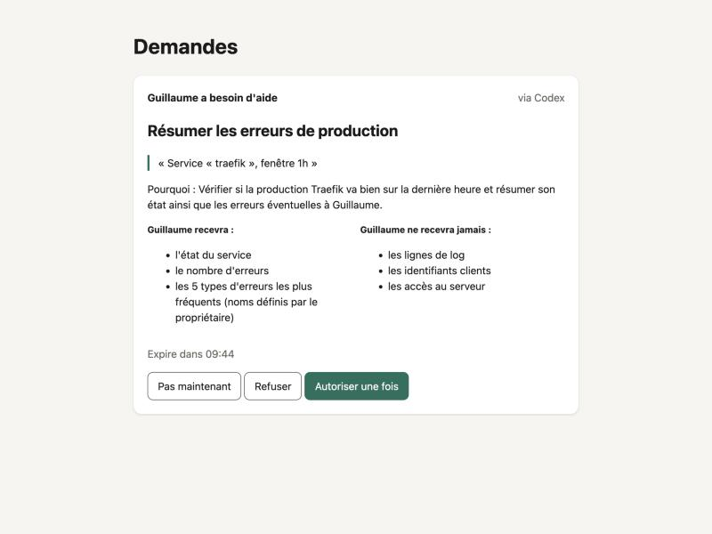
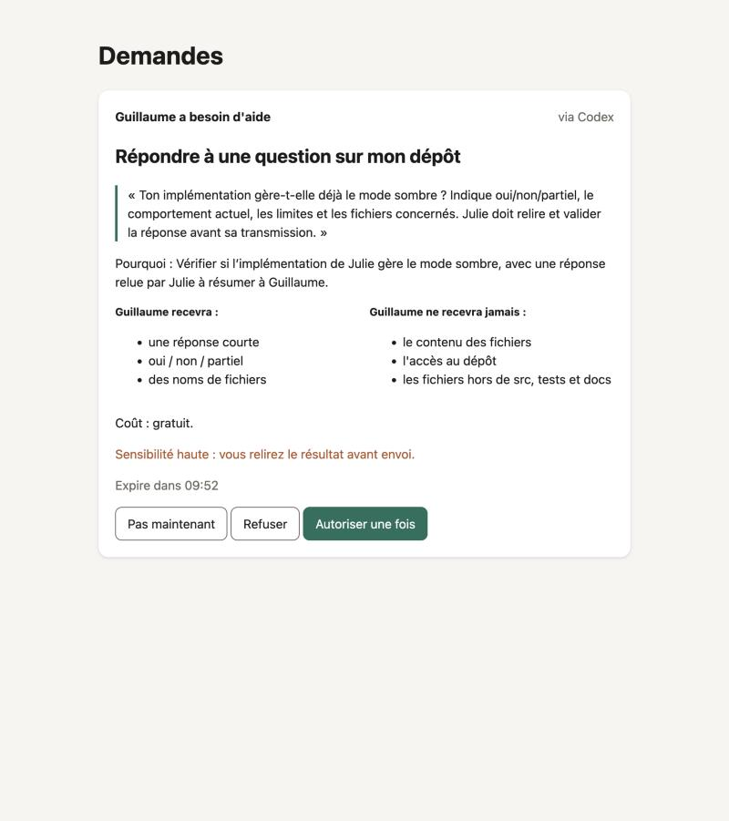
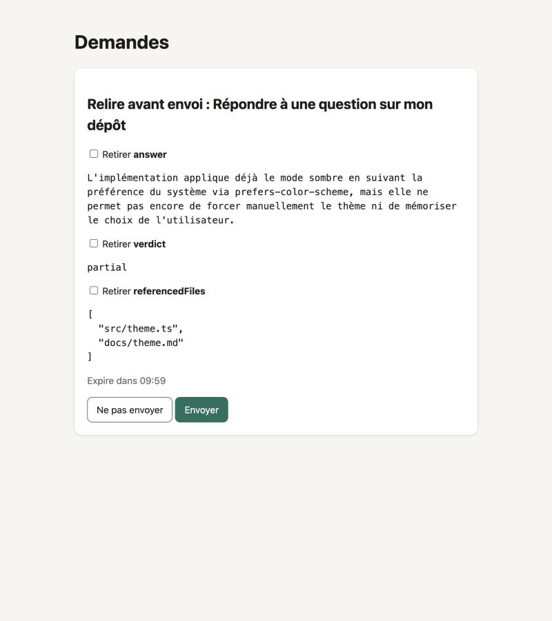

# Démo T1.14 : exécution réelle Mac + VPS, 8 octobre 2026

Scénario de la spec 08, joué en vrai : le relais public `wss://drop.memolabs.dev/v1` sur le VPS lab, le Node « lab »
dans le VPS, le Node « Guillaume » et le Node « Julie » sur le Mac. Le script pour la rejouer est
[`scripts/demo.md`](../../scripts/demo.md).

**L'agent demandeur est Codex**, pas Claude Code. Claude Code non interactif (`claude -p`) a échoué à
l'authentification (« OAuth session expired and could not be refreshed »), alors que son serveur MCP `drop` était
connecté. Codex a pris le relais avec le même serveur MCP. La démo montre ainsi que drop marche avec n'importe quel
agent MCP.

## Étapes 1 à 3 : « La prod de traefik va bien ? »

Appels MCP de Codex, dans l'ordre :

```text
drop/list_capabilities (completed)
drop/request_drop (completed)
drop/get_drop_result (completed)
```

La carte de consentement chez Guillaume, dans l'UI locale :



Après « Autoriser une fois », le VPS lit les logs de Traefik chez lui et ne renvoie que le résumé. Réponse finale de
Codex :

> Oui, d'après le résultat fourni par **lab**, Traefik est **OK** sur la dernière heure : **0 ligne d'erreur
> détectée**, aucun type d'erreur remonté.

## Étape 4 : « Est-ce que l'implémentation de Julie gère déjà le mode sombre ? »

La carte chez Julie. `repo.answer` est à sensibilité haute, et l'appel au modèle se fait avec la clé de Julie (ici
gratuit) :



Julie relit la réponse avant qu'elle parte, champ par champ, avec la possibilité d'en retirer un :



Réponse finale de Codex, après « Envoyer » :

> Julie confirme une prise en charge **partielle du mode sombre** : il s'active automatiquement selon la préférence du
> système, via `prefers-color-scheme`. Il n'est pas encore possible de choisir manuellement le thème ni de mémoriser
> ce choix. Les fichiers concernés sont `src/theme.ts` et `docs/theme.md`.

Les noms de fichiers sont là, sans une ligne de code. Le premier `request_drop` de Codex a échoué et il l'a relancé ;
le journal de Codex ne dit pas pourquoi. La cause la plus probable est une entrée refusée localement par
`requester-mcp` (question de plus de 300 caractères ou raison de plus de 140).

## Étape 5 : les reçus, des deux côtés

```text
== Guillaume
2026-10-08T14:59:38.884Z  production.error_summary  allow_once  01a11c06-eef4-7ff4-baca-b8feec85c1e0
2026-10-08T15:00:48.644Z  repo.answer  allow_once  01a11c07-ff67-7e2d-b6ec-1847d408d40d
== Julie
2026-10-08T15:00:48.644Z  repo.answer  allow_once  01a11c07-ff67-7e2d-b6ec-1847d408d40d
== lab (VPS)
2026-10-08T14:59:38.884Z  production.error_summary  allow_once  01a11c06-eef4-7ff4-baca-b8feec85c1e0
```

Chaque reçu est signé par l'exécuteur et ne contient que des empreintes : ni l'entrée, ni la sortie.

## Étape 6 : le test des 30 secondes

Pas faite : il faut montrer les étapes 1 à 3 à une vraie personne sans prononcer « MCP ». Le déroulé est dans
`scripts/demo.md`.

## Observé en passant

- Codex a d'abord tenté `blocked-observer/report_blocked` (la consigne de son `AGENTS.md`), refusé en mode non
  interactif : « MCP tool call requires approval, but approval policy is never ».
- La notification macOS s'affiche à chaque demande, en plus de l'UI.
