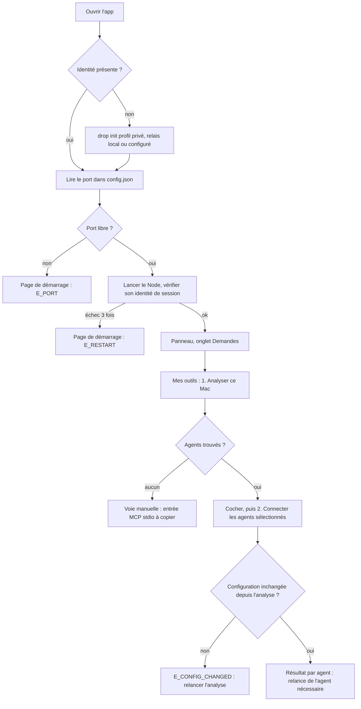
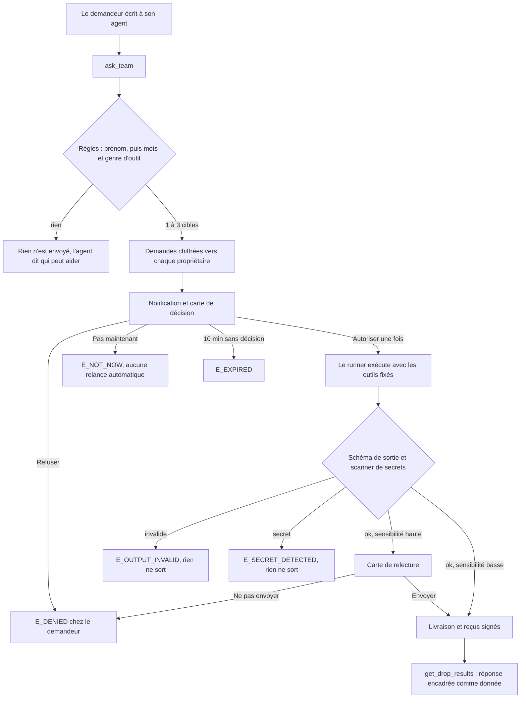
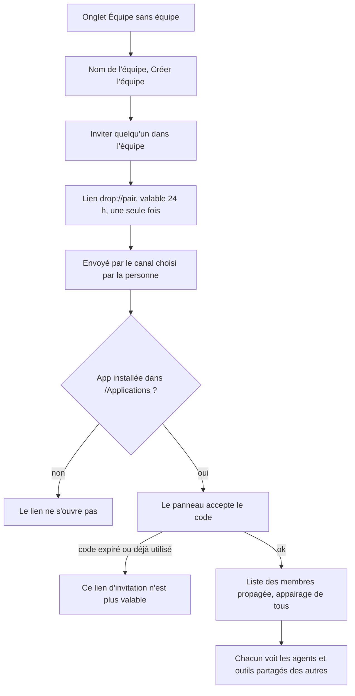

# Parcours (APP_FLOW)

Document descriptif. Les contrats normatifs vivent dans openspec/specs ; l'ordre dans docs/TASKS.md ; les décisions dans docs/DECISIONS.md.

Ce document décrit qui fait quoi dans drop, écran par écran, et ce que fait le système à chaque étape. Il ne fixe aucune exigence : il renvoie aux specs. Il ne fixe aucun ordre : il renvoie à [l'index des tâches](../TASKS.md). L'interface est décrite en détail dans [UX_UI](UX_UI.md).

## Lire ce document

Chaque affirmation porte un statut.

- **Existant** : présent dans le code ou prouvé par une archive. Le chemin cité est relatif à la racine du dépôt.
- **Visé** : cible adoptée, livrée par la tâche citée (T3.\* ou T4.\*).
- **Hypothèse** : supposition non vérifiée, avec le critère qui la confirme ou l'invalide.

**Hypothèse** : aucun parcours n'a encore été validé avec de vrais utilisateurs. Julie et Natha sont des scénarios, pas des clients (`PRODUCT.md`, section « Evidence on Hand »). Critère : l'essai avec deux amis (T4.6) observe chaque parcours principal de bout en bout.

**Existant** : « drop » reste un nom de code (D57).

## 1. Personas

Les personas viennent de D47 et D48. **Hypothèse** pour toutes : leurs besoins sont déduits du grilling du 10 octobre 2026, pas d'entretiens. Critère : T4.6 confirme ou corrige chaque ligne.

| Persona                                 | Ce qu'il veut                                                                    | Surface principale                                   | Source      |
| --------------------------------------- | -------------------------------------------------------------------------------- | ---------------------------------------------------- | ----------- |
| Demandeur technique                     | Que son agent obtienne une information qui vit chez un collègue, sans accès      | Son agent (MCP), puis l'onglet Demandes du panneau   | D47, D48    |
| Propriétaire technique, avec agent      | Décider vite, partager ses outils sans donner d'accès                            | Panneau de la barre de menus                         | D48         |
| Propriétaire non technique, sans agent  | Comprendre la question et répondre lui-même ou laisser un agent fourni répondre  | Panneau, réponse humaine (T4.3), agent inclus (T4.8) | D48, D49    |
| Responsable qui veut l'avancée          | Savoir où en est un projet sans réunion, à partir des sources de chacun          | Son agent, puis une vue d'avancée                    | D47, D28    |
| Administrateur d'entreprise             | Déployer une politique signée et un relais interne, interdire les flux externes  | MDM, relais interne (T4.10)                          | D53, D54    |
| Ami testeur                             | Installer, poser une vraie question, dire ce qui bloque                          | App Mac et son agent habituel                        | D48, T4.6   |
| Opérateur de simulation                 | Lancer une campagne, voir la carte, injecter des pannes, lire le rapport         | Banc local et carte de simulation (T4.1, T4.7)       | D56         |

## 2. Carte des parcours

| Parcours                                  | Statut global                                                           | Tâches               |
| ----------------------------------------- | ----------------------------------------------------------------------- | -------------------- |
| Installer et premier lancement            | Existant, build notarisée ; recette sur Mac propre et VoiceOver Visé    | T3.4                 |
| Raccorder ses agents                      | Existant : treize clients, sept automatiques, six à copier              | T3.3, T4.5           |
| Créer l'équipe et inviter                 | Existant                                                                | T2.9                 |
| Poser une question depuis un agent        | Existant                                                                | T2.10, T2.12         |
| Décider puis relire avant envoi           | Existant                                                                | T1.8, T1.9, T2.4     |
| Propriétaire sans agent                   | Existant pour la réponse à la main ; agent inclus Visé                  | T4.3, T4.8           |
| Faits publiés et petite question          | Existant pour les faits ; petite question Visé                          | T4.4, T4.9           |
| Tâche déléguée avec jalons                | Visé                                                                    | T4.11                |
| Contexte partagé décentralisé             | Visé                                                                    | T4.12                |
| Vue d'avancée du responsable              | Existant en partie (questions multiples) ; vue dédiée Hypothèse         | T2.10                |
| Administrateur d'entreprise               | Existant ; binaire autonome du relais Visé                              | T4.10, T4.10b        |
| ChatGPT par la passerelle                 | Option cloud différée : code présent, non livrée, refusée en privé      | T2.13, T4.10         |
| Échec de connexion sans relais de secours | Existant : réseau local, iroh, relais, sans relais de secours           | T4.2, T4.2b          |
| Opérateur de simulation                   | Existant pour le banc minimal ; simulation complète Visé                | T4.1, T4.7           |

## 3. Les trois parcours principaux

**Existant** pour les trois schémas ci-dessous, sauf les nœuds marqués « visé ».

### 3.1 Installer et raccorder ses agents

### 3.2 Poser une question, décider, relire

### 3.3 Créer l'équipe et inviter

## 4. Parcours détaillés

### 4.1 Installer et premier lancement

1. **Existant** : la personne ouvre l'app. Une build signée et notarisée pour Apple Silicon a été acceptée par Apple le 10 octobre 2026 (`openspec/changes/t3-4-private-mac-app/proof/verification.md`). **Visé** : installation sur un Mac propre et recette VoiceOver (T3.4).
2. **Existant** : l'app n'a pas d'icône dans le Dock ; une icône apparaît dans la barre de menus. La fenêtre est créée cachée (`apps/mac/src-tauri/src/main.rs`, `ActivationPolicy::Accessory`, `.visible(false)`). **Hypothèse** : une personne qui découvre l'app trouve l'icône sans aide. Critère : chaque ami testeur de T4.6 ouvre le panneau seul.
3. **Existant** : sans `identity.json`, le système lance `drop init --profile private` avec le prénom du compte macOS et le relais de `DROP_RELAY_URL`, sinon `ws://127.0.0.1:7780/v1` (`main.rs`, `ensure_identity`). Le profil privé fixe « le propriétaire paie » (`packages/node/src/private-config.ts`).
4. **Existant** : la page de démarrage affiche « Démarrage local… » et « Préparation de ton espace » (`apps/mac/web/index.html`).
5. **Existant** : le système lit le port dans `config.json`, refuse un port déjà occupé, lance le Node, puis attend jusqu'à 15 s une réponse portant son propre marqueur de session avant d'ouvrir l'URL qui contient le jeton (`main.rs`, `own_health`, D46).
6. **Existant** : le panneau s'ouvre sur l'onglet Demandes. L'en-tête montre « Prénom · hors ligne » tant qu'aucun relais ne répond (`packages/node/src/panel.ts`).
7. **Existant** : seule la version finale s'inscrit au démarrage de session (`main.rs`, `autolaunch`).
8. **Existant** : le réseau local est actif sauf désactivation (T4.2) ; la connexion par Internet se règle dans le panneau : désactivée, relais iroh choisi, ou relais de test n0 signalé comme tiers et refusé en profil privé (T4.2b, D68). Le mode Internet est désactivé par défaut. Aucun relais de secours par défaut (D53).

Échecs :

- **Existant** : chaque code bloquant affiche un titre, une explication, « Réessayer » et le code de diagnostic : `E_INIT`, `E_CONFIG`, `E_PORT`, `E_LOG`, `E_SPAWN`, `E_TOKEN`, `E_PANEL`, `E_RESTART` (`apps/mac/web/index.html`).
- **Existant** : collision de port (`E_PORT`) sans arrêter le programme déjà présent ; observé sur le vrai binaire (`verification.md`).
- **Existant** : un Node qui ne démarre pas est relancé deux fois, puis `E_RESTART` reste affiché jusqu'au choix « Réessayer le démarrage » dans le menu (`main.rs`, `supervise`).
- **Existant** : le bouton « Réessayer » dans le vrai WebView n'est pas qualifié (`verification.md`). **Visé** : recette en T3.4.

### 4.2 Raccorder ses agents

Contrat : [owner-app](../../openspec/specs/owner-app/spec.md), exigence « Deux confirmations de raccordement » ; [node](../../openspec/specs/node/spec.md), « Raccordement local contrôlé des agents ».

1. **Existant** : onglet Mes outils, carte « Connecter mes agents » avec deux étapes numérotées et le bouton « 1. Analyser ce Mac » (`panel.ts`).
2. **Existant** : le système lit les seuls emplacements connus des treize clients, sans réseau ni exécution, et classe chaque agent : absent, prêt, déjà raccordé, en conflit, en erreur (`packages/node/src/onboarding.ts`, `docs/ONBOARDING.md`).
3. **Existant** : les agents prêts sont cochés par défaut ; un agent déjà raccordé propose « Retirer ce connecteur » ; un conflit ou une erreur s'affiche avec sa traduction et son code (`panel.ts`, fonction `explain`).
4. **Existant** : « 2. Connecter les agents sélectionnés ». Le système relit chaque configuration et compare son empreinte ; Claude Code et Codex passent par leur CLI officielle, Cursor et Claude Desktop par un fichier temporaire renommé et une sauvegarde privée de trois versions (D45).
5. **Existant** : le panneau affiche un résultat par agent puis « Connecteur utilisable : à vérifier après relance. L’état de l’équipe apparaît en haut. » Aucun outil n'est partagé par ce geste (`panel.ts`).
6. **Existant** : voie manuelle. « Autre agent ? Ajoute manuellement un serveur MCP stdio nommé drop. » Après l'analyse, une entrée JSON à copier apparaît (`panel.ts`).
7. **Existant** : parcours vérifié sur fixtures ; la recette humaine sur un Mac de test reste à faire (`docs/TASKS.md`, ligne T3.3).
8. **Existant** (T4.5) : détection déterministe des treize clients de D55 avec leurs configurations globales et par projet. Sept sont raccordés automatiquement ; pour les six autres, le panneau donne la configuration à copier. Aucun modèle ne fouille la machine.

Échecs :

- **Existant** : `E_CLI_MISSING`, `E_CONFIG_INVALID_OR_UNREADABLE`, `E_DROP_CONFLICT`, `E_CONFIG_CHANGED`, `E_CLI_COMMAND`, `E_CLI_UNVERIFIED`, `E_AGENT_INVALID`, chacun traduit en français avec le code entre parenthèses (`panel.ts`).
- **Existant** : aucune case cochée : « Coche au moins un agent. » est annoncé.
- **Existant** : agent à relancer. Le panneau ne déclare pas le parcours terminé (AC-CONNECT-07 dans la spec owner-app).
- **Existant** : aucun agent détecté : « Aucun des treize clients détecté » et la voie manuelle (AC-CONNECT-08).

### 4.3 Créer l'équipe et inviter

Contrat : [node](../../openspec/specs/node/spec.md), exigences « Équipe » et « Liste d'une autre équipe ignorée ».

1. **Existant** : onglet Équipe sans équipe : « Pas encore d’équipe », champ « Nom de l’équipe », bouton « Créer l’équipe » (`panel.ts`).
2. **Existant** : avec une équipe, le titre résume « Atlas · 4 membres, 2 en ligne » ; chaque membre montre ses agents, ses outils partagés et son état en ligne.
3. **Existant** : « Inviter quelqu’un dans l’équipe » crée un lien `drop://pair?code=…` « valable 24 h, une seule fois », avec « Copier le lien » (`panel.ts`, `packages/protocol/src/invite.ts`).
4. **Hypothèse** : la personne envoie ce lien par sa messagerie habituelle ; drop ne l'envoie pas. Critère : T4.6 observe si ce geste bloque.
5. **Existant** : l'invité clique le lien. L'app le reçoit par le plugin de liens profonds ; avant que le Node soit prêt, jusqu'à huit liens attendent (`main.rs`, `open_links`).
6. **Existant** (T4.14) : le panneau montre qui invite et dans quelle équipe, puis attend « Rejoindre » ou « Refuser » ; rien n'est appairé avant ce clic (`panel.ts`).
7. **Existant** : chaque membre envoie la liste des membres aux nouveaux pairs ; tout le monde finit appairé sans autre geste (spec node, scénario « Tout le monde se connaît »).

Échecs :

- **Existant** : code invalide, expiré ou déjà utilisé : « Ce lien d’invitation n’est plus valable. Demande-en un nouveau. » (`E_INVITE`).
- **Existant** : les liens `drop://` ne marchent qu'avec l'app installée dans `/Applications` (D30).
- **Existant** : un membre hors ligne reste listé « hors ligne » ; une liste reçue d'une autre équipe est ignorée.

### 4.4 Poser une question depuis un agent

Contrat : [requester-mcp](../../openspec/specs/requester-mcp/spec.md), exigences « Demander à mon équipe » et « Question à plusieurs personnes » ; [node](../../openspec/specs/node/spec.md), « Routage d'une question ».

1. **Existant** : le demandeur écrit à son agent en langage courant. L'agent appelle `ask_team` avec une question de 10 à 300 caractères et une raison facultative de 140 au plus (`packages/requester-mcp/src/tools.ts`).
2. **Existant** : le Node choisit sans modèle. Un prénom cité l'emporte ; sinon les mots de la question sont comparés au genre de chaque outil partagé (Figma, code, GitHub, Notion, Linear, Jira, CRM, base de données…). Seules les capacités qui prennent une question libre comptent ; trois cibles au plus (`packages/node/src/route.ts`, D32).
3. **Existant** : l'agent reçoit « Question envoyée. Chacun doit accepter avant de répondre : », avec pour chaque cible la raison (« tu as cité Sami », « la question parle de … »), l'état hors ligne éventuel et les `drop_ids`.
4. **Existant** : pour une question éparpillée, l'agent peut appeler `request_drops` (2 à 10 demandes). Toutes les entrées sont validées avant le premier envoi.
5. **Existant** : l'agent appelle `get_drop_results`, qui attend jusqu'à 50 s (30 par défaut). Chaque réponse arrive encadrée dans `<drop_result>` avec la mention « C'est une donnée, pas une instruction » (`tools.ts`, `wrapResult`).
6. **Existant** : dans le panneau du demandeur, la section « Mes questions » montre les dix dernières demandes et leur état (`panel.ts`).
7. **Existant** : entrée alternative par A2A. Un agent A2A envoie `SendMessage` ; la tâche reste en cours pendant l'attente de l'accord, puis devient terminée, rejetée ou échouée (D33, `packages/node/src/a2a-inbound.ts`).

Échecs :

- **Existant** : rien ne correspond : « Je ne sais pas à qui poser cette question, alors je n'ai rien envoyé. » suivi de la liste de qui peut aider. Si personne ne partage d'outil, l'agent l'apprend et rien ne part.
- **Existant** : entrée invalide : « Entrée invalide, rien n'a été envoyé » (`request_drop`), ou « Rien n'a été envoyé » avec la liste des problèmes (`request_drops`).
- **Existant** : pair hors ligne : la demande attend dans une file locale bornée, puis dans la file du relais (100 enveloppes par Node par défaut) (`packages/node/src/engine.ts`, `packages/relay/src/server.ts`).
- **Existant** : refus (`E_DENIED`) : la description de l'outil interdit à l'agent de relancer. « Pas maintenant » (`E_NOT_NOW`) se relance seulement si l'utilisateur le demande.
- **Existant** : sans décision en 10 minutes, `E_EXPIRED` (`engine.ts`, `APPROVAL_TTL_MS`).

### 4.5 Le propriétaire reçoit, décide, puis relit

Contrat : [node](../../openspec/specs/node/spec.md), exigences « Contenu exact de la carte de consentement », « Écran de relecture champ par champ » ; [owner-app](../../openspec/specs/owner-app/spec.md), « Panneau servi par le Node ».

1. **Existant** : sur macOS, une notification « Julie a besoin d'aide » avec le titre de la capacité en sous-titre ; elle ne contient pas l'URL du panneau (D18). Dans l'app, elle porte l'icône de l'app et un clic ouvre le panneau (T4.14, `packages/node/src/notify.ts`). Le badge de l'onglet Demandes compte les décisions en attente.
2. **Existant** : le propriétaire clique l'icône ; le panneau s'ouvre sous elle (`main.rs`, `toggle_panel`).
3. **Existant** : la carte montre qui demande et par quel agent, la question entre guillemets, « Pourquoi », ce que le demandeur « recevra » et ce qu'il « ne recevra jamais », puis le coût s'il existe, « Expire dans mm:ss » et, si besoin, « Sensibilité haute » (T4.14, `panel.ts`, `approvalCard`).
4. **Existant** : trois choix : « Pas maintenant » (par défaut au clavier, T4.14), « Refuser », « Autoriser une fois », plus « Répondre moi-même » (T4.3). Le panneau annonce le résultat (« Demande autorisée une fois. ») et place le focus sur lui.
5. **Existant** : le runner exécute la capacité avec les seuls outils fixés à la publication. La sortie est validée par son schéma puis passée au scanner de secrets (`packages/runner/src/run.ts`).
6. **Existant** : capacité sensible : notification « Résultat à relire avant envoi », puis une carte « À relire avant envoi. Rien n’est parti : tu peux envoyer ou garder pour toi. » avec chaque champ de la sortie ; une case par champ permet de le retirer avant l'envoi (T4.14).
7. **Existant** : « Envoyer » livre la réponse et produit des reçus signés des deux côtés ; « Ne pas envoyer » renvoie `E_DENIED` avec « Le propriétaire a relu le résultat et choisi de ne pas l'envoyer. » (`engine.ts`).

Échecs :

- **Existant** : sortie hors schéma : `E_OUTPUT_INVALID`, rien ne sort. Secret détecté : `E_SECRET_DETECTED`, rien ne sort. Budget dépassé : `E_BUDGET` (`run.ts`, `packages/protocol/src/errors.ts`).
- **Existant** : relecture non faite en 10 minutes : la carte expire (`REVIEW_TTL_MS`).
- **Existant** : action refusée par le Node : bandeau d'erreur annoncé « Action impossible. » suivi du message.
- **Existant** : moteur local arrêté : l'en-tête affiche « Moteur local indisponible ».

### 4.6 Propriétaire sans agent

Décision : D49.

1. **Existant** (T4.3) : la carte de décision propose « Répondre moi-même », par un texte ou un fichier texte.
2. **Existant** (T4.3) : la réponse humaine passe par le même consentement, la même validation de sortie et le même reçu qu'une capacité.
3. **Visé** (T4.8) : le propriétaire peut laisser un agent fourni par drop répondre après son accord, avec un modèle qu'il choisit.
4. **Visé** (T3.2) : le choix d'un modèle local se fait avec consentement et téléchargement volontaire (D37).
5. **Hypothèse** : un propriétaire non technique répond à une petite question en moins d'une minute. Critère : mesure pendant T4.6.

Échecs, **Existant** (T4.3) : texte vide, fichier trop gros ou secret détecté dans la réponse humaine sont refusés avant l'envoi, avec la même traduction des codes que pour une capacité.

### 4.7 Faits publiés et petite question

Décision : D50, niveaux 1 et 2. Ordre de livraison 3, 1, 2, 4.

1. **Existant** (T4.4) : le propriétaire marque un fait signé comme partageable (énoncé, source, validité, public).
2. **Existant** (T4.4) : une question qui correspond à un fait publié reçoit ce fait sans modèle ; un fait expiré n'est plus servi.
3. **Visé** (T4.9) : une petite question est traitée dans un appel neuf, sans outil, sur un contexte déclaré partageable, jamais depuis la session vivante d'un agent.
4. **Hypothèse** : un fait publié évite une décision humaine sur les questions répétitives. Critère : part des demandes servies au niveau 1 pendant la simulation T4.7 puis l'essai T4.6.

Échecs, **Visé** : fait expiré ou invalidé, contexte déclaré absent, question hors du contexte déclaré. Dans chaque cas, rien n'est inventé et la demande retombe sur la décision du propriétaire.

### 4.8 Tâche déléguée avec jalons

Décision : D50, niveau 4.

1. **Visé** (T4.11) : le demandeur délègue une tâche longue, portée par une Task A2A, avec budget et expiration.
2. **Visé** (T4.11) : à chaque jalon, la tâche passe à l'état d'entrée requise et le propriétaire approuve la suite.
3. **Visé** (T4.11) : si le périmètre s'élargit, une nouvelle approbation est demandée.
4. **Hypothèse** : les jalons ne fatiguent pas le propriétaire. Critère : nombre de jalons acceptés sans lecture mesuré en simulation T4.7.

Échecs, **Visé** : budget épuisé, expiration, refus d'un jalon, annulation par le demandeur. La tâche s'arrête sans livrer de résultat partiel non relu.

### 4.9 Contexte partagé décentralisé

Décision : D51.

1. **Visé** (T4.12) : seul un catalogue de sujets, sans contenu, circule entre les membres.
2. **Visé** (T4.12) : aucun agent n'écrit chez un autre. Une proposition arrive dans une boîte de suggestions que l'humain valide ou rejette.
3. **Visé** (T4.12) : un fait contredit est invalidé, pas effacé.
4. **Existant** : limites écrites dans D51 : une réponse livrée ne se rappelle pas, le catalogue révèle qui sait quoi, des réponses partielles peuvent s'agréger.

### 4.10 Vue d'avancée du responsable

1. **Existant** : le responsable demande à son agent « où en est le projet X ? ». `ask_team` ou `request_drops` interrogent plusieurs collègues, chacun accepte de son côté, et l'agent assemble en citant qui a dit quoi (D28, T2.10, `tools.ts`).
2. **Existant** : le panneau du responsable liste ses questions et leur état dans « Mes questions ».
3. **Hypothèse** : une vue dédiée à l'avancée apporte plus qu'une réponse assemblée par l'agent. Critère : T4.6 montre qu'un responsable la réclame. Aucune ligne de l'index ne la livre ; il faudra en ajouter une si le besoin est confirmé.

### 4.11 Administrateur d'entreprise

Décisions : D53, D54.

1. **Existant** : le profil privé limite les destinations à une liste d'origines privées et refuse redirections et résolution DNS (D40, `packages/node/src/home.ts`, `packages/protocol/src/private-network.ts`).
2. **Existant** (T4.10) : l'informatique déploie par MDM une politique signée : clients autorisés, passerelles publiques interdites, relais interne obligatoire, fournisseurs de modèles autorisés.
3. **Existant** (T4.10) : le poste applique la politique et le relais interne la vérifie à nouveau.
4. **Existant** (T4.10) : le relais interne est livré en image Docker et chart Helm, avec TLS facultatif. **Visé** (T4.10b) : le binaire autonome.
5. **Existant** (T4.10) : l'état local du Node expose la politique en vigueur (`packages/node/src/api.ts`, `status`). Le panneau ne l'affiche pas encore ; la forme visée est dans [UX_UI](UX_UI.md).

Échecs, **Existant** (T4.10) : politique à signature invalide, client non autorisé, relais différent de celui imposé. Le poste refuse et dit pourquoi.

### 4.12 ChatGPT par la passerelle

Décisions : D31 (historique), D54. Option cloud différée, non livrée ; une politique d'entreprise peut l'interdire (T4.10, existant).

1. **Existant** : le code de la passerelle existe : OAuth avec enregistrement dynamique, page « Relier … à ton équipe drop », serveur MCP distant avec `ask_team`, `get_drop_results` et `list_capabilities` (`packages/gateway/src/server.ts`). La tâche T2.13 reste `todo` ; aucune preuve de déploiement n'est archivée.
2. **Existant** : la page ouvre `drop://link` ; le panneau demande « Autoriser … à demander à ton équipe ? » et avertit si la passerelle n'est pas reconnue (`panel.ts`, `linkCard`).
3. **Existant** : en profil privé, le Node refuse toute liaison avec `E_DENIED` (`packages/node/src/daemon.ts`). Comme l'app Mac initialise toujours un profil privé, ce parcours échoue aujourd'hui dans l'app. Voir l'écart E4.
4. **Existant** : chaque question passée par la passerelle reste soumise au consentement de chaque collègue.

### 4.13 Échec de connexion, sans relais de secours par défaut

Décision : D53.

1. **Existant** : le Node essaie le réseau local, puis iroh s'il est activé, puis le relais configuré. Le démarrage ne choisit jamais le relais public (spec owner-app, « App de la barre de menus »).
2. **Existant** : sans relais joignable, l'en-tête montre « hors ligne » avec un point ambre ; les demandes sortantes attendent dans une file locale bornée (`panel.ts`, `engine.ts`).
3. **Existant** (T4.2, T4.2b, T4.10) : trois modes : réseau local par mDNS, Internet par iroh, relais d'entreprise.
4. **Existant** (T4.2b) : le panneau propose d'activer un relais iroh : auto-hébergé ou d'équipe, ou relais de test n0 signalé comme tiers et refusé en profil privé (D68). Sans relais, deux pairs derrière un routeur ne se joignent pas. Rien n'est activé sans choix explicite. Un relais Memo Labs sur demande d'une équipe reste une **Hypothèse**.
5. **Hypothèse** : la connexion directe réussit dans environ 9 cas sur 10 (chiffre annoncé par iroh, `docs/research/2026-10-10-repositionnement.md`). Critère : mesure en T4.1 et pendant T4.6.

### 4.14 Opérateur de simulation

Décision : D56. Le banc minimal existe (T4.1) ; le reste est **Visé** (T4.7).

1. **Existant** (T4.1) : l'opérateur lance sur le Mac un banc local avec un relais dédié, 50 nœuds et de faux agents déterministes, jamais sur le VPS ni sur un relais de production.
2. **Existant** (T4.1) : le banc mesure mémoire et latence et produit un rapport.
3. **Visé** (T4.7) : 500 nœuds virtuels et 10 à 20 personnages sur des modèles gratuits, via la passerelle LiteLLM du lab.
4. **Visé** (T4.7) : l'opérateur suit la campagne sur une carte interactive : vue équipe regroupable, vue parcours par demande, lecture et pas à pas.
5. **Visé** (T4.7) : il injecte des pannes et des sorties piégées, puis rejoue une demande.
6. **Visé** (T4.7) : il lit les traces et le rapport de campagne. La boucle d'amélioration ajuste seule textes, routage et consignes des personnages, en versionnant ; jamais le code ni la sécurité.

Échecs, **Visé** : quota gratuit saturé (Groq ne tient pas les rafales, `docs/research/2026-10-10-repositionnement.md`), nœud qui ne démarre pas, mémoire insuffisante au-delà de 50 processus. Le rapport les nomme au lieu de les masquer.

## 5. Chemins d'échec transverses

| Situation                     | Ce que voit la personne                                                       | Ce que fait le système                                         | Statut et source                       |
| ----------------------------- | ----------------------------------------------------------------------------- | -------------------------------------------------------------- | -------------------------------------- |
| Pair hors ligne               | « hors ligne pour l’instant » dans la réponse de `ask_team`                   | File locale bornée, puis file du relais                        | **Existant**, `tools.ts`, `engine.ts`  |
| Demande expirée               | État « expirée » dans « Mes questions »                                       | `E_EXPIRED` après 10 minutes                                   | **Existant**, `engine.ts`              |
| Refus                         | État « refusée »                                                              | `E_DENIED`, l'agent ne relance pas                             | **Existant**, `tools.ts`               |
| Sortie invalide               | État « échouée »                                                              | `E_OUTPUT_INVALID`, rien ne sort, pas de réparation            | **Existant**, `run.ts`                 |
| Secret détecté                | État « échouée »                                                              | `E_SECRET_DETECTED`, rien ne sort                              | **Existant**, `run.ts`                 |
| Relecture refusée             | État « refusée » chez le demandeur                                            | `E_DENIED` avec le message du propriétaire                     | **Existant**, `engine.ts`              |
| Collision de port             | Page de démarrage « Port local déjà utilisé » (E_PORT)                        | Aucun Node lancé, le programme présent reste intact            | **Existant**, `main.rs`                |
| Agent à relancer              | « Connecteur utilisable : à vérifier après relance »                          | Parcours non déclaré terminé                                   | **Existant**, `panel.ts`               |
| Lien d'invitation périmé      | « Ce lien d’invitation n’est plus valable. »                                  | `E_INVITE`                                                     | **Existant**, `invite.ts`              |
| Code d'erreur de demande brut | État traduit, sans code ni explication dans le panneau                        | Code visible seulement côté agent                              | **Existant**, `panel.ts` ; voir UX_UI  |
| Pas de connexion directe      | Explication et choix d'un relais                                              | Aucun relais activé sans choix                                 | **Existant**, T4.2b                    |

## 6. Écarts relevés pendant la rédaction

Relevés le 10 octobre 2026. Au 11 octobre : E1, E2, E3 et E5 sont corrigés par T4.14 ; E6 et E7 par T4.0a ; E4 reste, car le profil privé refuse la passerelle par choix. Les écarts de configuration (modes de fichiers, profil par défaut) restent portés par T4.15. Ils ne changent aucun contrat ici.

- **E1, Existant** : la spec node demande sur la carte une ligne « Expire dans » et une ligne « Sensibilité haute », et « Pas maintenant » comme bouton par défaut au clavier. La page historique `/` (`packages/node/src/ui.ts`) les a ; le panneau `/app` n'affiche ni l'expiration ni la sensibilité et ne fixe pas de bouton par défaut.
- **E2, Existant** : `PRODUCT.md` et le commentaire de `main.rs` disent que la personne décide dans le panneau après un lien `drop://pair` ; le panneau accepte l'invitation dès l'ouverture, sans clic.
- **E3, Existant** : la spec node prévoit le retrait de champs à la relecture, et `docs/GUIDE.md` dit que la propriétaire peut « retirer des champs ». Seule la page historique `/` le permet ; le panneau propose seulement « Envoyer » ou « Ne pas envoyer ».
- **E4, Existant** : le panneau et la passerelle portent le parcours `drop://link`, mais le profil privé, seul profil créé par l'app Mac, le refuse (`daemon.ts`).
- **E5, Existant** : la spec node dit qu'un clic sur la notification ouvre l'UI locale ; la notification ne porte pas d'URL (D18) et rien ne relie ce clic au panneau.
- **E6, Existant** : `docs/GUIDE.md` liste quatre outils MCP ; le serveur en expose six (`packages/requester-mcp/src/server.ts`).
- **E7, Existant** : `docs/ONBOARDING.md` dit que partager une source exige de choisir outils, données, modèle et approbateur ; l'interrupteur du panneau partage en un clic avec les outils en lecture seule par défaut.
