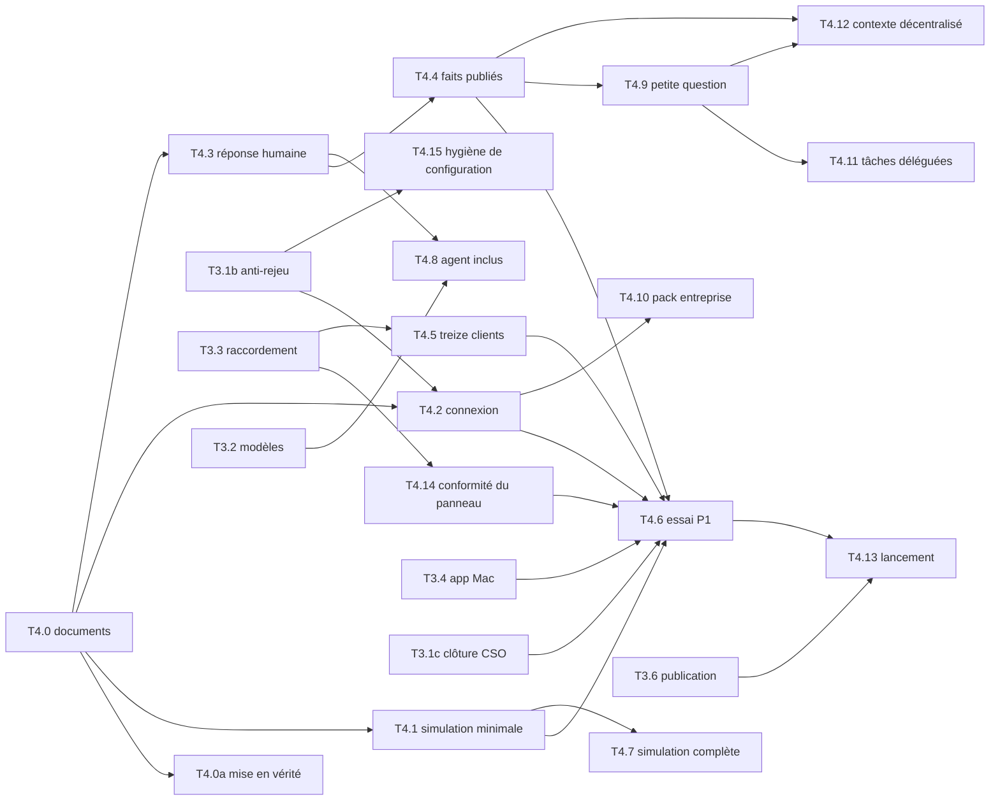

# Plan d'implémentation

Document descriptif. Les contrats normatifs vivent dans `openspec/specs` ; l'ordre dans `docs/TASKS.md` ; les décisions dans `docs/DECISIONS.md`.

Ce plan regroupe les tâches de l'index en phases et donne, pour chacune, son but et sa condition de sortie. Il ne fixe pas l'ordre à lui seul : en cas d'écart, [`docs/TASKS.md`](../TASKS.md) fait foi. Décisions de référence : D47 à D58.

## Règles communes

- Une tâche = une change OpenSpec, selon AGENTS.md : lire, lever les doutes (grilling), proposer, attendre l'accord, tests d'abord, vérifier, archiver.
- Chaque tâche promeut ses critères dans les specs avant de coder ; les scénarios `AC:` portent leur sélecteur de test.
- Toute nouvelle dépendance est justifiée dans `docs/DECISIONS.md` par la change qui l'introduit (iroh pour T4.2, React Flow pour T4.7).
- Statut final contrôlé par l'agent : READY_FOR_MANUAL_ACCEPTANCE. Les recettes humaines restent ouvertes tant qu'elles ne sont pas faites.

## Le chemin de sécurité T3 reste prioritaire

La série T3 garde son ordre et ses prérequis (voir l'index). Points qui conditionnent les phases suivantes :

| Tâche | Pourquoi elle compte ici | État au 10 octobre 2026 |
|---|---|---|
| T3.1b, T3.1c | bornes anti-rejeu et mémoire ; le risque CSO HIGH doit être clos avant tout pilote | T3.1b en cours chez Codex, T3.1c bloquée |
| T3.1d, T3.1e | résilience protocole et stockage avant usage multi-organisation | todo |
| T3.2 | qualification des modèles, prérequis de l'agent inclus (T4.8) | todo |
| T3.4 | app Mac distribuable ; une build acceptée par Apple le 10 octobre, preuve à archiver, recette VoiceOver et Mac de test restantes | blocked |
| T3.5 | preuve privée d'ensemble | todo |

L'essai avec de vraies personnes (T4.6) ne démarre pas avant la clôture CSO de T3.1c (D24 et T3.1c le demandent déjà avant tout pilote).

## P0 : documents et mise en vérité

| Tâche | Contenu |
|---|---|
| T4.0 | Les six documents produit de `docs/product/` |
| T4.0a | Réécrire ou réduire à un renvoi la vision, PRODUCT.md, le README, le guide, le site et les specs touchées |

**Sortie.** Aucun document du dépôt ni page du site ne contredit D47 à D58. Chaque affirmation « Existant » renvoie à une preuve.

## Simulation minimale

| Tâche | Contenu |
|---|---|
| T4.1 | Banc local, relais dédié, 50 nœuds en processus séparés, faux agents déterministes, mesure mémoire et latence, rapport |

**Sortie.** Une campagne de 50 nœuds tourne sans erreur sur le Mac ; la mémoire par nœud et la latence de bout en bout sont mesurées et deviennent la référence de régression. Le relais de production `drop.memolabs.dev` et le VPS ne sont jamais utilisés.

## P1 : essai avec deux amis

| Tâche | Contenu |
|---|---|
| T4.2 | Découverte locale, iroh embarqué, échec expliqué, relais de secours seulement sur choix explicite |
| T4.3 | Réponse humaine du propriétaire |
| T4.4 | Faits publiés (niveau 1) |
| T4.5 | Détection des treize clients MCP |
| T4.14 | Panneau conforme à la spec : expiration et bouton par défaut sur la carte, retrait de champs à la relecture, confirmation avant d’accepter une invitation |
| T4.15 | Hygiène de configuration : profil privé par défaut, modes de fichiers 0600 |
| T4.6 | Essai réel, protocole d'observation, mesure D24 |

**Sortie.**

- Deux amis, dans deux contextes différents, ont installé l'app, échangé des demandes réelles et répondu au protocole.
- Le seuil D24 est mesuré, qu'il soit atteint ou non : un résultat négatif est un résultat, et il oriente la suite.
- H3 (compréhension) et H5 (connexions directes) ont une mesure.

## P2 : simulation complète

| Tâche | Contenu |
|---|---|
| T4.7 | 500 nœuds virtuels, 10 à 20 personnages sur modèles gratuits, carte interactive, traces Langfuse, rapports, boucle d'amélioration bornée |

**Sortie.**

- Une campagne de 500 nœuds tient sur le Mac avec des seuils de mémoire et de latence écrits.
- Les personnages exécutent les scénarios des niveaux 1 et 3 avec pannes et sorties piégées injectées ; chaque sortie piégée est refusée et visible sur la carte.
- La boucle d'amélioration n'a modifié que des éléments autorisés, tous versionnés.

## P3 : élargir à ceux qui n'ont pas d'agent et aux entreprises

| Tâche | Contenu |
|---|---|
| T4.8 | Agent inclus, modèle choisi par le propriétaire |
| T4.9 | Petite question (niveau 2) sur contexte déclaré |
| T4.10 | Pack entreprise : relais binaire, Docker, Helm ; politique signée appliquée au poste et au relais |

**Sortie.**

- Un propriétaire sans agent répond via l'agent inclus après accord.
- Une petite question ne lit jamais la session vivante d'un agent (test dédié).
- Une politique qui interdit un client ou une passerelle est appliquée par le poste et refusée à nouveau par le relais, même si le poste a été modifié.

## P4 : délégation et contexte

| Tâche | Contenu |
|---|---|
| T4.11 | Tâches déléguées (niveau 4) sur Task A2A, jalons d'approbation, budget, expiration |
| T4.12 | Contexte partagé décentralisé : faits signés, catalogue de sujets, boîte de suggestions, invalidation |

**Sortie.**

- Une tâche déléguée s'arrête à chaque jalon et redemande l'accord si son périmètre s'élargit.
- Aucun agent ne peut écrire un fait chez un autre.
- Un fait expiré n'est plus servi.

## P5 : nom, offre, lancement

| Tâche | Contenu |
|---|---|
| T3.6 | Préparation de publication (audit, licences, CI, signalement) |
| T4.13 | Nom, offre, lancement public, chacun soumis à l'accord humain |

**Sortie.** Publication décidée par Guillaume, sur un dépôt audité, avec un site qui ne promet rien d'invérifiable.

## Vue d'ensemble

Les dépendances ci-dessus recopient celles de l'index à la date du 10 octobre 2026 ; l'index fait foi.

## Ce qui reste humain

- Recette T3.4 sur un Mac de test sans Node, avec VoiceOver.
- Recrutement et suivi des deux amis (T4.6).
- Choix du nom (T4.13, D57).
- Toute publication, tout envoi à un tiers, toute création de clé sur la passerelle LiteLLM partagée.
